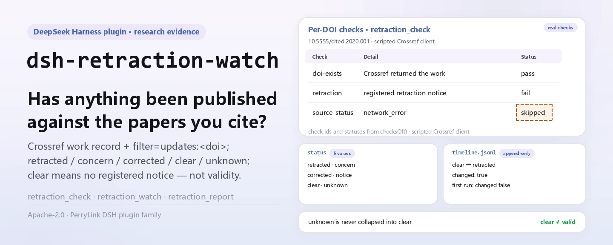
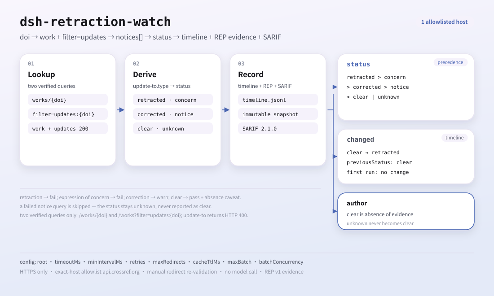
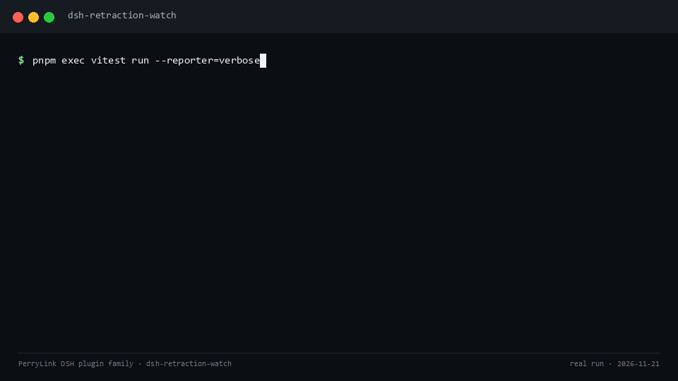

<div align="center">

<picture>
  <source media="(prefers-color-scheme: dark)" srcset="docs/assets/dsh-retraction-watch-hero-en-dark.webp">
  
</picture>

# dsh-retraction-watch

**¿Se ha publicado algo contra los artículos que citas?**

*Registros de trabajo de Crossref + la consulta `filter=updates:<doi>` verificada, un estado por DOI, una línea de tiempo append-only que muestra los cambios y evidencia REP que puedes releer. `clear` significa que no hay ningún aviso registrado — nunca "este artículo es válido".*

[English](README.md) · [简体中文](README-zh.md) · [Español](README-es.md) · [Português](README-pt.md) · [हिन्दी](README-hi.md)

[](LICENSE)
[]()

</div>

---

## Qué hace

- `retraction_check(doi)` → `retracted` / `concern` / `corrected` / `notice` / `clear` / `unknown`, con los DOI de los avisos y un registro de evidencia REP que guarda ambas respuestas de Crossref.
- `retraction_watch(dois)` → lo mismo para una bibliografía, con **detección de cambios**: la línea de tiempo registra cada estado observado, así que "clear → retracted" se informa como un cambio.
- `retraction_report(items)` → tabla Markdown + SARIF 2.1.0 (retractaciones/concerns = errores, correcciones = advertencias).


<picture>
  <source media="(prefers-color-scheme: dark)" srcset="docs/assets/dsh-retraction-watch-flow-v5-dark.svg">
  
</picture>

*Estructura: consultar → derivar → registrar; `status` y `changed` son las dos salidas, y una consulta de avisos fallida es una comprobación `skipped` que deja el estado en `unknown` — nunca en `clear`. Las etiquetas dentro del diagrama son los nombres reales de herramientas, consultas y campos, así que la misma imagen sirve para los cinco idiomas.*

## Capacidad del proveedor verificada (no supuesta)

| Consulta | Resultado |
|---|---|
| `GET /works/{doi}` | el trabajo citado; si lleva `update-to`, el DOI *es* un aviso |
| `GET /works?filter=updates:{doi}` | trabajos que actualizan este DOI — **verificado en vivo, HTTP 200** (2026-11-08) |
| `GET /works?filter=update-to:{doi}` | **no existe**, HTTP 400 |
| `filter=relation.type:is-retracted-by` | **no es un relation type válido**, HTTP 400 |

El plugin solo usa las dos consultas que funcionan. Cuando falla la consulta de actualizaciones informa `unknown` y una comprobación `skipped` — nunca `clear`.

## Significado de los estados

| Estado | Significado |
|---|---|
| `retracted` | un aviso de retractación apunta a este DOI |
| `concern` | una expresión de preocupación apunta a él |
| `corrected` | un aviso de corrección apunta a él |
| `notice` | un aviso de actualización de otro tipo apunta a él |
| `clear` | Crossref **no tiene registrado** ningún aviso de actualización |
| `unknown` | el DOI no está en Crossref, o la consulta falló |

`clear` es ausencia de evidencia, no evidencia de validez: los avisos de Crossref pueden retrasarse respecto a la publicación, y la cobertura de Retraction Watch **no** se consulta en v0.1. `unknown` nunca se colapsa en `clear`.

## Qué no hace

- **Sin ingesta de Retraction Watch** (licencia/cobertura por revisar antes de ese paso).
- **Sin juicio de calidad**: una corrección no hace que un artículo esté mal, y no se evalúan los motivos de una retractación.
- **Sin scraping** más allá de las dos consultas a Crossref; sin CNKI, sin Sci-Hub.
- **Sin ejecutor programado**: la línea de tiempo se actualiza cada vez que se llama a la herramienta; la programación corresponde al host (`dsh-jobs`) o al usuario.

## Compatibilidad e instalación

| | |
|---|---|
| DeepSeek Harness | **`dsh-v0.2.2-rc.4`** (verificado 2026-11-18); peer `>=0.2.1-0 <0.3.0 \|\| >=0.2.2-0 <0.3.0` |
| Node | `^22.19.0 \|\| >=24.9.0` (probado `24.22.1`), solo ESM |
| Pares | `@perrylink/dsh-research-core ^0.1.0`, `@deepseek-ai/cordis ^4.0.5-alpha.1`, `@deepseek-ai/dsh-tools`, `@deepseek-ai/schemastery ^3.18.5-alpha.1` |
| Dependencias en tiempo de ejecución | **cero** |

```sh
dsh plugin --profile <name> add @perrylink/dsh-research-core dsh-retraction-watch
dsh --profile <name> --dump-config | grep dsh-retraction-watch
```

## Configuración

| Clave | Predeterminado | Significado |
|---|---|---|
| `enabled` | `true` | `false` no monta nada |
| `root` | `.retraction-watch` | raíz del almacén, la caché, la línea de tiempo y los registros |
| `userAgent` | `dsh-retraction-watch/0.1.0 (…)` | se envía a Crossref |
| `mailto` | — | contacto del polite pool de Crossref (opcional) |
| `timeoutMs` | `15000` | plazo por solicitud |
| `minIntervalMs` | `150` | intervalo por host |
| `retries` / `maxRedirects` | `1` / `3` | presupuesto acotado de reintentos y redirecciones |
| `cacheTtlMs` | `604800000` | caché de respuestas (7 días; `fresh` la omite) |
| `maxBatch` / `batchConcurrency` | `50` / `3` | límites de `retraction_watch` |

## Límites de seguridad

- Solo HTTPS, lista de permitidos por host exacto (`api.crossref.org`), sin credenciales en las URL, sin puertos personalizados.
- Las redirecciones se siguen manualmente y **cada salto se revalida** contra la lista de permitidos.
- Las respuestas se guardan como instantáneas inmutables; la evidencia registra URL, nunca secretos.
- Las respuestas en caché son best-effort: un fallo de caché es un miss, nunca un resultado de comprobación.

## Evaluación



*Animado: la salida real de `pnpm exec vitest run --reporter=verbose` y la puerta del paquete (reejecutado el 2026-11-21; hoy la suite tiene 24 pruebas — el párrafo de evaluación de abajo sigue contando 23). Cada respuesta de Crossref de la suite está guionizada, así que la ejecución no hace ninguna llamada de red.*


**23 pruebas** en tres archivos: mapeo de tipos de actualización, filtrado de avisos, precedencia del estado agregado, construcción de comprobaciones (clear / retracted / unknown / fallo de red), runtime (retractación, clear con advertencia, 404 → unknown, consulta de actualizaciones fallida → unknown, corrección, DOI inválido, re-comprobación sin conflicto de evidencia, sin caché de un 5xx transitorio, contacto del polite pool fuera de la evidencia guardada), detección de cambios en la línea de tiempo a lo largo de tres ejecuciones (la primera observación no es un cambio), aislamiento por elemento en el lote, límite del lote, esquemas/renderizadores de herramientas, contrato del paquete.

Conjunto de muestras manual (no se declara ningún benchmark para este plugin; su corrección es el contrato de Crossref, no una decisión aprendida):

| Escenario | Esperado | Cubierto por |
|---|---|---|
| un aviso de retractación apunta al DOI | `retracted`, check `fail` | test |
| aviso de corrección | `corrected`, check `warn` | test |
| expresión de preocupación | `concern`, check `fail` | test |
| sin avisos | `clear` + advertencia de ausencia | test |
| DOI que no está en Crossref | `unknown`, `not_found` skipped | test |
| consulta de actualizaciones con 5xx | `unknown`, `network_error` skipped | test |
| el estado cambia entre ejecuciones | `changed: true`, `previousStatus` | test |
| primera observación de un DOI | `changed: false`, sin `previousStatus` | test |

## Limitaciones conocidas (v0.1)

- Los datos de Retraction Watch no se consultan; cobertura solo de Crossref.
- Un aviso publicado sin un enlace `update-to` de Crossref es invisible aquí.
- La línea de tiempo es JSONL append-only sin compactación; poda manualmente para bibliografías muy grandes.
- Sin alertas por correo o webhook; el sondeo lo tiene que impulsar quien llama.

## Licencia

Apache-2.0. Ningún código de terceros en tiempo de ejecución.
