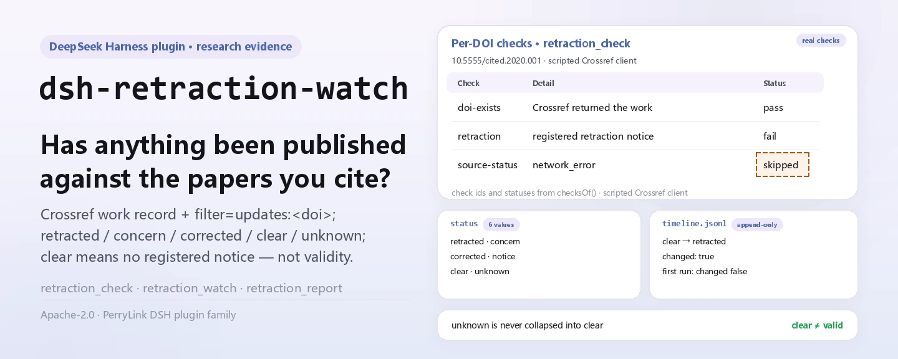
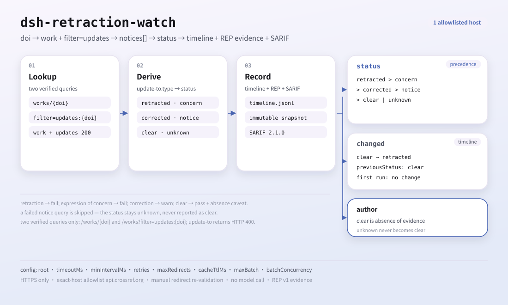
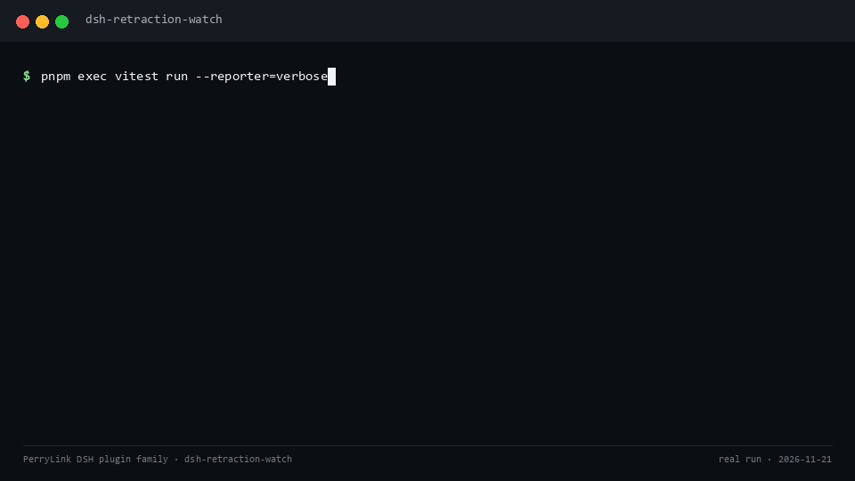

<div align="center">

<picture>
  <source media="(prefers-color-scheme: dark)" srcset="docs/assets/dsh-retraction-watch-hero-en-dark.webp">
  
</picture>

# dsh-retraction-watch

**आप जिन पेपरों को उद्धृत करते हैं, उनके खिलाफ़ कुछ प्रकाशित हुआ है क्या?**

*Crossref वर्क रिकॉर्ड + सत्यापित `filter=updates:<doi>` क्वेरी, प्रति-DOI स्टेटस, बदलाव दिखाने वाली append-only टाइमलाइन, और ऐसा REP एविडेंस जिसे आप दोबारा पढ़ सकते हैं। `clear` का मतलब है कोई पंजीकृत नोटिस नहीं — कभी भी "यह पेपर मान्य है" नहीं।*

[English](README.md) · [简体中文](README-zh.md) · [Español](README-es.md) · [Português](README-pt.md) · [हिन्दी](README-hi.md)

[](LICENSE)
[]()

</div>

---

## यह क्या करता है

- `retraction_check(doi)` → `retracted` / `concern` / `corrected` / `notice` / `clear` / `unknown`, साथ में नोटिसों के DOI और दोनों Crossref रिस्पॉन्स रखने वाला एक REP एविडेंस रिकॉर्ड।
- `retraction_watch(dois)` → किसी बिब्लियोग्राफ़ी के लिए वही, **बदलाव का पता लगाने** के साथ: टाइमलाइन हर देखे गए स्टेटस को दर्ज करती है, इसलिए "clear → retracted" बदलाव के रूप में रिपोर्ट होता है।
- `retraction_report(items)` → Markdown टेबल + SARIF 2.1.0 (retractions/concerns = errors, corrections = warnings)।


<picture>
  <source media="(prefers-color-scheme: dark)" srcset="docs/assets/dsh-retraction-watch-flow-v5-dark.svg">
  
</picture>

*संरचना: देखना → निकालना → दर्ज करना; `status` और `changed` दो आउटपुट हैं, और विफल नोटिस क्वेरी एक `skipped` जाँच है जो स्टेटस को `unknown` ही रखती है — कभी `clear` नहीं। आरेख के अंदर के लेबल असली टूल, क्वेरी और फ़ील्ड नाम हैं, इसलिए वही चित्र पाँचों भाषाओं के काम आता है।*

## प्रोवाइडर क्षमता सत्यापित (अनुमान नहीं)

| क्वेरी | नतीजा |
|---|---|
| `GET /works/{doi}` | उद्धृत काम; अगर उसमें `update-to` है तो वह DOI *स्वयं* एक नोटिस है |
| `GET /works?filter=updates:{doi}` | वे काम जो इस DOI को अपडेट करते हैं — **लाइव सत्यापित, HTTP 200** (2026-11-08) |
| `GET /works?filter=update-to:{doi}` | **मौजूद नहीं है**, HTTP 400 |
| `filter=relation.type:is-retracted-by` | **मान्य relation type नहीं है**, HTTP 400 |

प्लगइन सिर्फ़ वही दो क्वेरी इस्तेमाल करता है जो काम करती हैं। अपडेट क्वेरी विफल होने पर वह `unknown` और एक `skipped` जाँच बताता है — कभी `clear` नहीं।

## स्टेटस के अर्थ

| स्टेटस | अर्थ |
|---|---|
| `retracted` | इस DOI की ओर एक रिट्रैक्शन नोटिस इशारा करता है |
| `concern` | इसकी ओर एक एक्सप्रेशन ऑफ़ कंसर्न इशारा करता है |
| `corrected` | इसकी ओर एक करेक्शन नोटिस इशारा करता है |
| `notice` | किसी दूसरे प्रकार का अपडेट नोटिस इसकी ओर इशारा करता है |
| `clear` | Crossref के पास **कोई पंजीकृत** अपडेट नोटिस नहीं है |
| `unknown` | DOI Crossref में नहीं है, या लुकअप विफल हो गया |

`clear` साक्ष्य का अभाव है, वैधता का साक्ष्य नहीं: Crossref के नोटिस प्रकाशन से देर से आ सकते हैं, और v0.1 में Retraction Watch कवरेज **नहीं** देखा जाता। `unknown` को कभी `clear` में नहीं मिलाया जाता।

## यह क्या नहीं करता

- **Retraction Watch इनजेशन नहीं** (उस कदम से पहले लाइसेंस/कवरेज की जाँच बाकी है)।
- **गुणवत्ता का फ़ैसला नहीं**: एक करेक्शन किसी पेपर को गलत नहीं बनाता, और रिट्रैक्शन के कारणों का मूल्यांकन नहीं होता।
- **scraping नहीं** दो Crossref क्वेरी के अलावा; न CNKI, न Sci-Hub।
- **शेड्यूल्ड रनर नहीं**: टाइमलाइन तब अपडेट होती है जब टूल कॉल होता है; शेड्यूलिंग होस्ट (`dsh-jobs`) या उपयोगकर्ता की ज़िम्मेदारी है।

## संगतता और इंस्टॉल

| | |
|---|---|
| DeepSeek Harness | **`dsh-v0.2.2-rc.4`** (2026-11-18 को सत्यापित); peer `>=0.2.1-0 <0.3.0 \|\| >=0.2.2-0 <0.3.0` |
| Node | `^22.19.0 \|\| >=24.9.0` (`24.22.1` पर टेस्टेड), केवल ESM |
| पीयर्स | `@perrylink/dsh-research-core ^0.1.0`, `@deepseek-ai/cordis ^4.0.5-alpha.1`, `@deepseek-ai/dsh-tools`, `@deepseek-ai/schemastery ^3.18.5-alpha.1` |
| रनटाइम डिपेंडेंसी | **शून्य** |

```sh
dsh plugin --profile <name> add @perrylink/dsh-research-core dsh-retraction-watch
dsh --profile <name> --dump-config | grep dsh-retraction-watch
```

## कॉन्फ़िगरेशन

| कुंजी | डिफ़ॉल्ट | अर्थ |
|---|---|---|
| `enabled` | `true` | `false` होने पर कुछ भी माउंट नहीं होता |
| `root` | `.retraction-watch` | स्टोर, कैश, टाइमलाइन और रिकॉर्ड की जड़ |
| `userAgent` | `dsh-retraction-watch/0.1.0 (…)` | Crossref को भेजा जाता है |
| `mailto` | — | Crossref polite-pool संपर्क (वैकल्पिक) |
| `timeoutMs` | `15000` | प्रति-अनुरोध समय-सीमा |
| `minIntervalMs` | `150` | प्रति-होस्ट अंतराल |
| `retries` / `maxRedirects` | `1` / `3` | सीमित रीट्राई और रीडायरेक्ट बजट |
| `cacheTtlMs` | `604800000` | रिस्पॉन्स कैश (7 दिन; `fresh` इसे बायपास करता है) |
| `maxBatch` / `batchConcurrency` | `50` / `3` | `retraction_watch` की सीमाएँ |

## सुरक्षा सीमाएँ

- केवल HTTPS, सटीक-होस्ट allowlist (`api.crossref.org`), URL में कोई क्रेडेंशियल नहीं, कोई कस्टम पोर्ट नहीं।
- रीडायरेक्ट मैन्युअली फ़ॉलो होते हैं और **हर हॉप allowlist के सामने दोबारा जाँचा जाता है**।
- रिस्पॉन्स अपरिवर्तनीय स्नैपशॉट के रूप में सहेजे जाते हैं; एविडेंस URL दर्ज करता है, कभी सीक्रेट नहीं।
- कैश किए रिस्पॉन्स best-effort हैं: कैश विफलता एक miss है, कभी जाँच का नतीजा नहीं।

## मूल्यांकन



*एनिमेटेड: असली `pnpm exec vitest run --reporter=verbose` आउटपुट और पैकेज गेट (2026-11-21 को दोबारा चलाया गया; आज सूट में 24 टेस्ट हैं)। सूट में हर Crossref जवाब स्क्रिप्ट किया हुआ है, इसलिए यह रन कोई नेटवर्क कॉल नहीं करता।*


**24 टेस्ट** चार फ़ाइलों में: अपडेट-टाइप मैपिंग, नोटिस फ़िल्टरिंग, समग्र स्टेटस की प्राथमिकता, जाँचों का निर्माण (clear / retracted / unknown / नेटवर्क विफलता), रनटाइम (रिट्रैक्शन, चेतावनी के साथ clear, 404 → unknown, अपडेट क्वेरी विफल → unknown, करेक्शन, अमान्य DOI, एविडेंस कॉन्फ़्लिक्ट के बिना दोबारा जाँच, क्षणिक 5xx का कैश न होना, polite-pool संपर्क सहेजे एविडेंस से बाहर), तीन रनों में टाइमलाइन बदलाव का पता लगाना (पहला अवलोकन बदलाव नहीं है), प्रति-आइटम बैच अलगाव, बैच सीमा, टूल स्कीमा/रेंडरर, पैकेज कॉन्ट्रैक्ट।

मैन्युअल सैंपल सेट (इस प्लगइन के लिए कोई बेंचमार्क नहीं बताया गया; इसकी शुद्धता Crossref का कॉन्ट्रैक्ट है, कोई सीखा हुआ फ़ैसला नहीं):

| परिदृश्य | अपेक्षित | किसके द्वारा कवर |
|---|---|---|
| रिट्रैक्शन नोटिस DOI की ओर इशारा करता है | `retracted`, check `fail` | test |
| करेक्शन नोटिस | `corrected`, check `warn` | test |
| एक्सप्रेशन ऑफ़ कंसर्न | `concern`, check `fail` | test |
| कोई नोटिस नहीं | `clear` + अभाव की चेतावनी | test |
| DOI Crossref में नहीं है | `unknown`, `not_found` skipped | test |
| अपडेट क्वेरी 5xx | `unknown`, `network_error` skipped | test |
| रनों के बीच स्टेटस बदलता है | `changed: true`, `previousStatus` | test |
| किसी DOI का पहला अवलोकन | `changed: false`, कोई `previousStatus` नहीं | test |

## ज्ञात सीमाएँ (v0.1)

- Retraction Watch डेटा नहीं देखा जाता; केवल Crossref कवरेज।
- Crossref `update-to` लिंक के बिना प्रकाशित नोटिस यहाँ अदृश्य है।
- टाइमलाइन append-only JSONL है, कोई कम्पैक्शन नहीं; बहुत बड़ी बिब्लियोग्राफ़ी के लिए मैन्युअली छाँटें।
- कोई ई-मेल/वेबहुक अलर्ट नहीं; पोलिंग कॉलर को चलानी होती है।

## लाइसेंस

Apache-2.0. रनटाइम में कोई तृतीय-पक्ष कोड नहीं।
