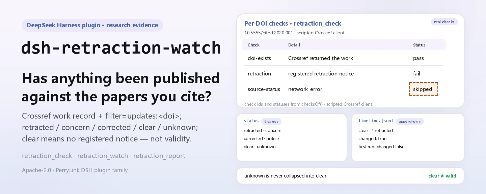
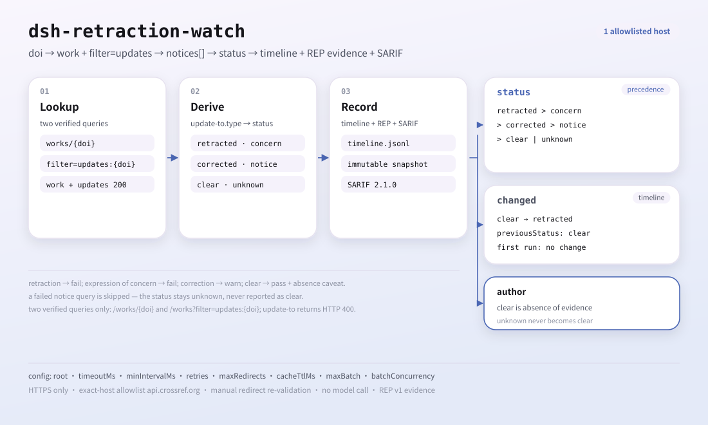
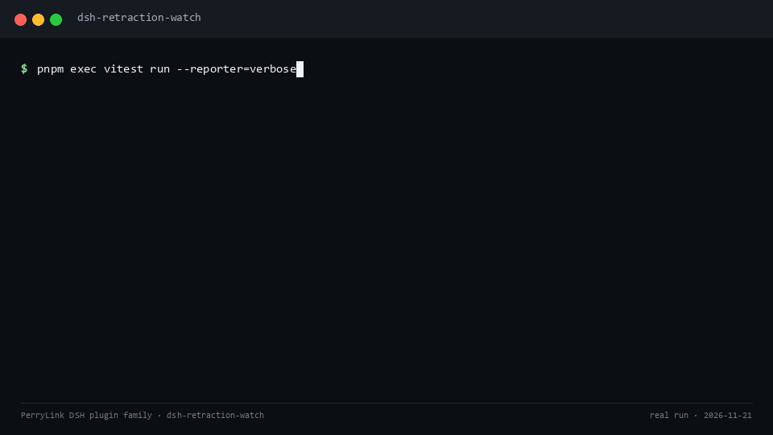

<div align="center">

<picture>
  <source media="(prefers-color-scheme: dark)" srcset="docs/assets/dsh-retraction-watch-hero-en-dark.webp">
  
</picture>

# dsh-retraction-watch

**Já foi publicado algo contra os artigos que você cita?**

*Registros de trabalho do Crossref + a consulta `filter=updates:<doi>` verificada, um estado por DOI, uma linha do tempo append-only que mostra mudanças e evidência REP que você pode reler. `clear` significa que não há aviso registrado — nunca "este artigo é válido".*

[English](README.md) · [简体中文](README-zh.md) · [Español](README-es.md) · [Português](README-pt.md) · [हिन्दी](README-hi.md)

[](LICENSE)
[]()

</div>

---

## O que ele faz

- `retraction_check(doi)` → `retracted` / `concern` / `corrected` / `notice` / `clear` / `unknown`, com os DOIs dos avisos e um registro de evidência REP contendo as duas respostas do Crossref.
- `retraction_watch(dois)` → o mesmo para uma bibliografia, com **detecção de mudanças**: a linha do tempo registra cada estado observado, então "clear → retracted" é reportado como mudança.
- `retraction_report(items)` → tabela Markdown + SARIF 2.1.0 (retratações/concerns = erros, correções = avisos).


<picture>
  <source media="(prefers-color-scheme: dark)" srcset="docs/assets/dsh-retraction-watch-flow-v5-dark.svg">
  
</picture>

*Estrutura: consultar → derivar → registrar; `status` e `changed` são as duas saídas, e uma consulta de avisos que falhou é uma verificação `skipped` que deixa o estado em `unknown` — nunca em `clear`. Os rótulos dentro do diagrama são os nomes reais de ferramentas, consultas e campos, então a mesma imagem serve aos cinco idiomas.*

## Capacidade do provedor verificada (não suposta)

| Consulta | Resultado |
|---|---|
| `GET /works/{doi}` | o trabalho citado; se ele carrega `update-to`, o DOI *é* um aviso |
| `GET /works?filter=updates:{doi}` | trabalhos que atualizam este DOI — **verificado ao vivo, HTTP 200** (2026-11-08) |
| `GET /works?filter=update-to:{doi}` | **não existe**, HTTP 400 |
| `filter=relation.type:is-retracted-by` | **não é um relation type válido**, HTTP 400 |

O plugin usa apenas as duas consultas que funcionam. Quando a consulta de atualizações falha, ele reporta `unknown` e uma verificação `skipped` — nunca `clear`.

## Significado dos estados

| Estado | Significado |
|---|---|
| `retracted` | um aviso de retratação aponta para este DOI |
| `concern` | uma expressão de preocupação aponta para ele |
| `corrected` | um aviso de correção aponta para ele |
| `notice` | um aviso de atualização de outro tipo aponta para ele |
| `clear` | o Crossref **não tem registrado** nenhum aviso de atualização |
| `unknown` | o DOI não está no Crossref, ou a consulta falhou |

`clear` é ausência de evidência, não evidência de validade: os avisos do Crossref podem atrasar em relação à publicação, e a cobertura do Retraction Watch **não** é consultada na v0.1. `unknown` nunca é colapsado em `clear`.

## O que ele não faz

- **Sem ingestão do Retraction Watch** (licença/cobertura a revisar antes desse passo).
- **Sem julgamento de qualidade**: uma correção não torna um artigo errado, e os motivos de uma retratação não são avaliados.
- **Sem scraping** além das duas consultas ao Crossref; sem CNKI, sem Sci-Hub.
- **Sem executor agendado**: a linha do tempo é atualizada sempre que a ferramenta é chamada; o agendamento pertence ao host (`dsh-jobs`) ou ao usuário.

## Compatibilidade e instalação

| | |
|---|---|
| DeepSeek Harness | **`dsh-v0.2.2-rc.4`** (verificado em 2026-11-18); peer `>=0.2.1-0 <0.3.0 \|\| >=0.2.2-0 <0.3.0` |
| Node | `^22.19.0 \|\| >=24.9.0` (testado em `24.22.1`), somente ESM |
| Pares | `@perrylink/dsh-research-core ^0.1.0`, `@deepseek-ai/cordis ^4.0.5-alpha.1`, `@deepseek-ai/dsh-tools`, `@deepseek-ai/schemastery ^3.18.5-alpha.1` |
| Dependências de execução | **zero** |

```sh
dsh plugin --profile <name> add @perrylink/dsh-research-core dsh-retraction-watch
dsh --profile <name> --dump-config | grep dsh-retraction-watch
```

## Configuração

| Chave | Padrão | Significado |
|---|---|---|
| `enabled` | `true` | `false` não monta nada |
| `root` | `.retraction-watch` | raiz do armazenamento, cache, linha do tempo e registros |
| `userAgent` | `dsh-retraction-watch/0.1.0 (…)` | enviado ao Crossref |
| `mailto` | — | contato do polite pool do Crossref (opcional) |
| `timeoutMs` | `15000` | prazo por requisição |
| `minIntervalMs` | `150` | intervalo por host |
| `retries` / `maxRedirects` | `1` / `3` | orçamento limitado de retentativas e redirecionamentos |
| `cacheTtlMs` | `604800000` | cache de respostas (7 dias; `fresh` a ignora) |
| `maxBatch` / `batchConcurrency` | `50` / `3` | limites do `retraction_watch` |

## Limites de segurança

- Somente HTTPS, lista de permitidos por host exato (`api.crossref.org`), sem credenciais nas URLs, sem portas personalizadas.
- Os redirecionamentos são seguidos manualmente e **cada salto é revalidado** contra a lista de permitidos.
- As respostas são guardadas como instantâneos imutáveis; a evidência registra URLs, nunca segredos.
- Respostas em cache são best-effort: uma falha de cache é um miss, nunca um resultado de verificação.

## Avaliação



*Animado: a saída real de `pnpm exec vitest run --reporter=verbose` e o portão do pacote (reexecutado em 2026-11-21; hoje a suíte tem 24 testes — o parágrafo de avaliação abaixo ainda conta 23). Cada resposta do Crossref na suíte é roteirizada, então a execução não faz nenhuma chamada de rede.*


**23 testes** em três arquivos: mapeamento de tipos de atualização, filtragem de avisos, precedência do estado agregado, construção de verificações (clear / retracted / unknown / falha de rede), runtime (retratação, clear com ressalva, 404 → unknown, consulta de atualizações falha → unknown, correção, DOI inválido, reverificação sem conflito de evidência, sem cache de um 5xx transitório, contato do polite pool fora da evidência guardada), detecção de mudanças na linha do tempo ao longo de três execuções (a primeira observação não é mudança), isolamento por item no lote, limite do lote, esquemas/renderizadores de ferramentas, contrato do pacote.

Conjunto de amostras manual (nenhum benchmark é declarado para este plugin; sua correção é o contrato do Crossref, não uma decisão aprendida):

| Cenário | Esperado | Coberto por |
|---|---|---|
| um aviso de retratação aponta para o DOI | `retracted`, check `fail` | test |
| aviso de correção | `corrected`, check `warn` | test |
| expressão de preocupação | `concern`, check `fail` | test |
| sem avisos | `clear` + ressalva de ausência | test |
| DOI que não está no Crossref | `unknown`, `not_found` skipped | test |
| consulta de atualizações com 5xx | `unknown`, `network_error` skipped | test |
| o estado muda entre execuções | `changed: true`, `previousStatus` | test |
| primeira observação de um DOI | `changed: false`, sem `previousStatus` | test |

## Limitações conhecidas (v0.1)

- Os dados do Retraction Watch não são consultados; cobertura apenas do Crossref.
- Um aviso publicado sem link `update-to` do Crossref é invisível aqui.
- A linha do tempo é JSONL append-only sem compactação; pode manualmente para bibliografias muito grandes.
- Sem alertas por e-mail ou webhook; o polling precisa ser conduzido por quem chama.

## Licença

Apache-2.0. Nenhum código de terceiros em tempo de execução.
