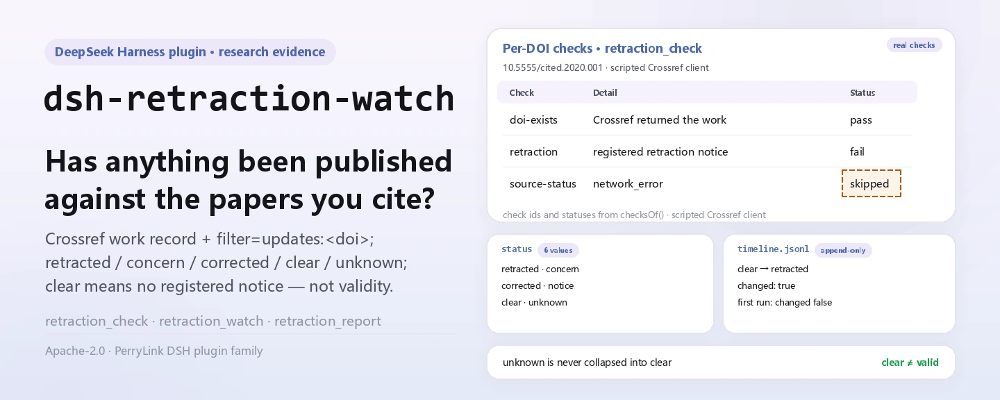
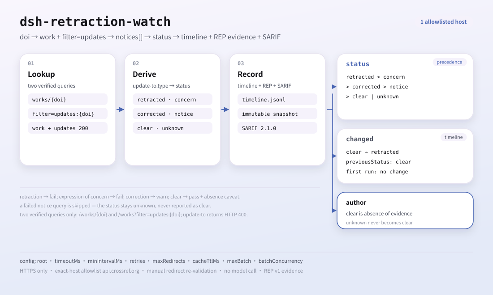
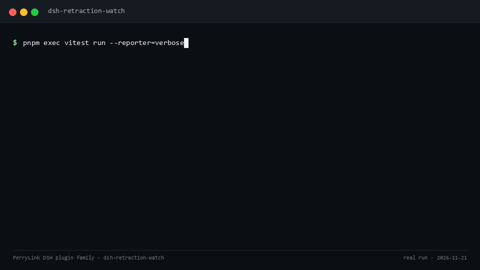

<div align="center">

<picture>
  <source media="(prefers-color-scheme: dark)" srcset="docs/assets/dsh-retraction-watch-hero-en-dark.webp">
  
</picture>

# dsh-retraction-watch

**Has anything been published against the papers you cite?**

*Crossref work records + the verified `filter=updates:<doi>` query, a per-DOI status, an append-only timeline that shows changes, and REP evidence you can re-read. `clear` means no registered notice — never "this paper is valid".*

[简体中文](README-zh.md) · [Español](README-es.md) · [Português](README-pt.md) · [हिन्दी](README-hi.md)

[](LICENSE)
[]()

</div>

---

## What it does

- `retraction_check(doi)` → `retracted` / `concern` / `corrected` / `notice` / `clear` / `unknown`, with the notice DOIs and a REP evidence record holding both Crossref responses.
- `retraction_watch(dois)` → the same for a bibliography, with **change detection**: the timeline records every observed status, so "clear → retracted" is reported as a change.
- `retraction_report(items)` → Markdown table + SARIF 2.1.0 (retractions/concerns = errors, corrections = warnings).


<picture>
  <source media="(prefers-color-scheme: dark)" srcset="docs/assets/dsh-retraction-watch-flow-v5-dark.svg">
  
</picture>

*Structure: lookup → derive → record; `status` and `changed` are the two outputs, and a failed notice query is a `skipped` check that leaves the status `unknown` — never `clear`. The token labels inside the diagram are the real tool, query and field names, so the same picture serves all five languages.*

## Verified provider capability (not guessed)

| Query | Result |
|---|---|
| `GET /works/{doi}` | the cited work; if it carries `update-to`, the DOI *is* a notice |
| `GET /works?filter=updates:{doi}` | works that update this DOI — **verified live, HTTP 200** (2026-11-08) |
| `GET /works?filter=update-to:{doi}` | **does not exist**, HTTP 400 |
| `filter=relation.type:is-retracted-by` | **not a valid relation type**, HTTP 400 |

The plugin only uses the two working queries. When the update query fails it reports `unknown` and a `skipped` check — never `clear`.

## Status meanings

| Status | Meaning |
|---|---|
| `retracted` | a retraction notice points at this DOI |
| `concern` | an expression of concern points at it |
| `corrected` | a correction notice points at it |
| `notice` | an update notice of another type points at it |
| `clear` | Crossref has **no registered** update notice |
| `unknown` | the DOI is not in Crossref, or the lookup failed |

`clear` is absence of evidence, not evidence of validity: Crossref notices can lag publication, and Retraction Watch coverage is **not** queried in v0.1. `unknown` is never collapsed into `clear`.

## What it does not do

- **No Retraction Watch ingestion** (licence/coverage to be checked before that step).
- **No quality judgement**: a correction does not make a paper wrong, and a retraction's reasons are not evaluated.
- **No scraping** beyond the two Crossref queries; no CNKI, no Sci-Hub.
- **No scheduled runner**: the timeline is updated whenever the tool is called; scheduling belongs to the host (`dsh-jobs`) or the user.

## Compatibility & install

| | |
|---|---|
| DeepSeek Harness | **`dsh-v0.2.2-rc.4`** (verified 2026-11-18); peer `>=0.2.1-0 <0.3.0 \|\| >=0.2.2-0 <0.3.0` |
| Node | `^22.19.0 \|\| >=24.9.0` (tested `24.22.1`), ESM only |
| Peers | `@perrylink/dsh-research-core ^0.1.0`, `@deepseek-ai/cordis ^4.0.5-alpha.1`, `@deepseek-ai/dsh-tools`, `@deepseek-ai/schemastery ^3.18.5-alpha.1` |
| Runtime dependencies | **zero** |

```sh
dsh plugin --profile <name> add @perrylink/dsh-research-core dsh-retraction-watch
dsh --profile <name> --dump-config | grep dsh-retraction-watch
```

## Configuration

| Key | Default | Meaning |
|---|---|---|
| `enabled` | `true` | `false` mounts nothing |
| `root` | `.retraction-watch` | store, cache, timeline and records root |
| `userAgent` | `dsh-retraction-watch/0.1.0 (…)` | sent to Crossref |
| `mailto` | — | Crossref polite-pool contact (optional) |
| `timeoutMs` | `15000` | per-request deadline |
| `minIntervalMs` | `150` | per-host interval |
| `retries` / `maxRedirects` | `1` / `3` | bounded retry and redirect budget |
| `cacheTtlMs` | `604800000` | response cache (7 days; `fresh` bypasses) |
| `maxBatch` / `batchConcurrency` | `50` / `3` | `retraction_watch` bounds |

## Security boundaries

- HTTPS only, exact-host allowlist (`api.crossref.org`), no credentials in URLs, no custom ports.
- Redirects are followed manually and **each hop is re-validated** against the allowlist.
- Responses are stored as immutable snapshots; the evidence records URLs, never secrets.
- Cached responses are best-effort: a cache failure is a miss, never a check result.

## Evaluation



*Animated: the real `pnpm exec vitest run --reporter=verbose` output and the package gate (re-run 2026-11-21; the suite has 24 tests today — the evaluation paragraph below still counts 24). Every Crossref answer in the suite is scripted, so the run makes no network call.*


**24 tests** across four files: update-type mapping, notice filtering, aggregate status precedence, check construction (clear / retracted / unknown / network failure), runtime (retraction, clear with caveat, 404 → unknown, failed update query → unknown, correction, invalid DOI, re-check without an evidence conflict, no caching of a transient 5xx, polite-pool contact kept out of stored evidence), timeline change detection across three runs (the first observation is not a change), per-item batch isolation, batch cap, tool schemas/renderers, package contract.

Manual sample set (no benchmark is claimed for this plugin; its correctness is the Crossref contract, not a learned decision):

| Scenario | Expected | Covered by |
|---|---|---|
| retraction notice points at the DOI | `retracted`, check `fail` | test |
| correction notice | `corrected`, check `warn` | test |
| expression of concern | `concern`, check `fail` | test |
| no notices | `clear` + absence caveat | test |
| DOI not in Crossref | `unknown`, `not_found` skipped | test |
| update query 5xx | `unknown`, `network_error` skipped | test |
| status changes between runs | `changed: true`, `previousStatus` | test |
| first observation of a DOI | `changed: false`, no `previousStatus` | test |

## Known limitations (v0.1)

- Retraction Watch data is not queried; Crossref-only coverage.
- A notice published without a Crossref `update-to` link is invisible here.
- The timeline is append-only JSONL with no compaction; prune manually for very large bibliographies.
- No email/webhook alerts; polling must be driven by the caller.

## License

Apache-2.0. No third-party runtime code.
